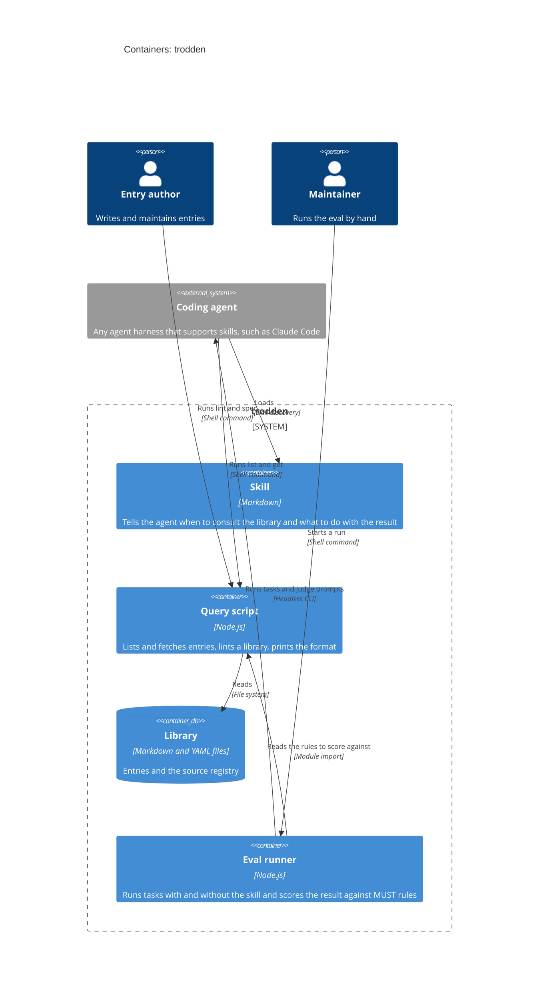

# Containers

- The **skill**, the **query script** and the **library** ship together in one folder, `skills/trodden/`, which works wherever it is copied.
- The **eval runner** lives outside that folder, in `evals/`, and is not part of what an agent installs.
- The eval's judge is a model reached through the same coding agent command line, so there is one credential.
