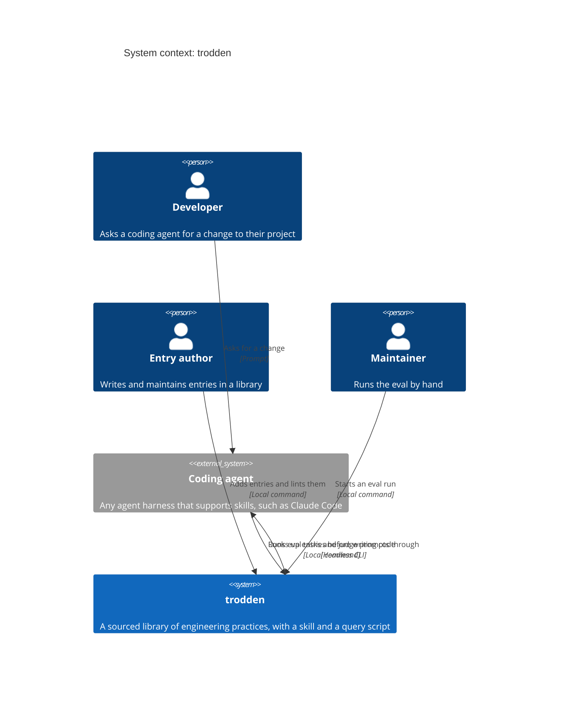

# System context

- A **developer** never touches trodden directly. Their agent consults it.
- trodden reaches nothing over the network when an agent queries it. Only the eval drives an agent, and through it a model.
