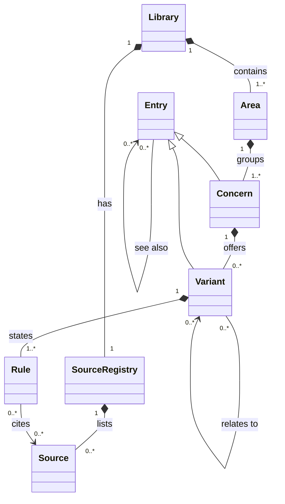

# Domain Model

How a trodden library is put together: the entries it holds, the rules they state and the sources that back them. Terms are defined in [`GLOSSARY.md`](../GLOSSARY.md).

## Concepts and relationships

- A **Library** contains one or more **Areas** and has exactly one **Source registry**.
- A **Source registry** lists zero or more **Sources**.
- An **Area** groups one or more **Concerns**.
- A **Concern** offers zero or more **Variants**. A concern is meant to have at least one, but nothing enforces it.
- A **Variant** states one or more **Rules**.
- A **Rule** cites zero or more **Sources**.
- A **Variant** relates to other **Variants** through a **Relationship**: `requires`, `refines`, `conflicts-with` or `alternative`.
- A **Concern** and a **Variant** are both **Entries**.
- Any **Entry** may point to any other **Entry** with a `see also` **Relationship**. It is the only one a **Concern** may declare.

## Invariants

- Every **MUST** cites at least one **Source**.
- A **SHOULD** may have no **Source**.
- Every **Source** an **Entry** cites is in the **Source registry** of the same **Library**.
- Every **Relationship** points to an **Entry** that exists, or is marked as planned.
- `requires` **Relationships** never form a loop.
- An **Entry**'s id always matches its place in the **Library**.
- A **Variant** always belongs to a **Concern**.
- An **Entry** never names a programming language or a library.
- A **Rule** never copies the text of its **Source**.

The **Linter** checks all of these except the last two, which are editorial.
