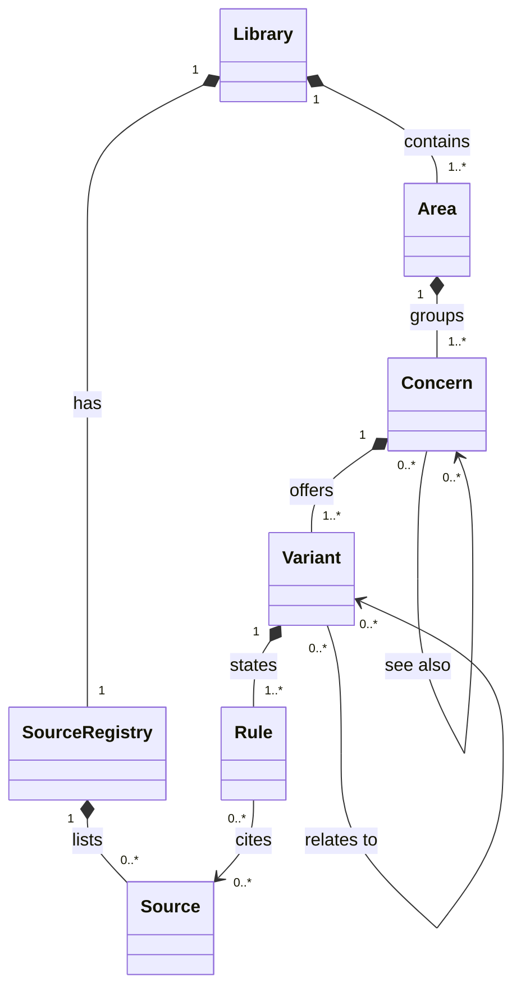
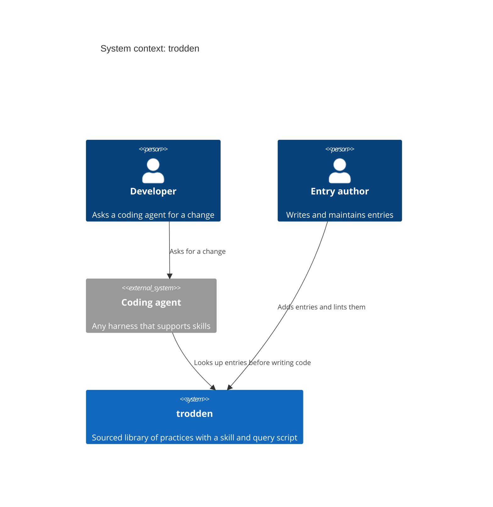
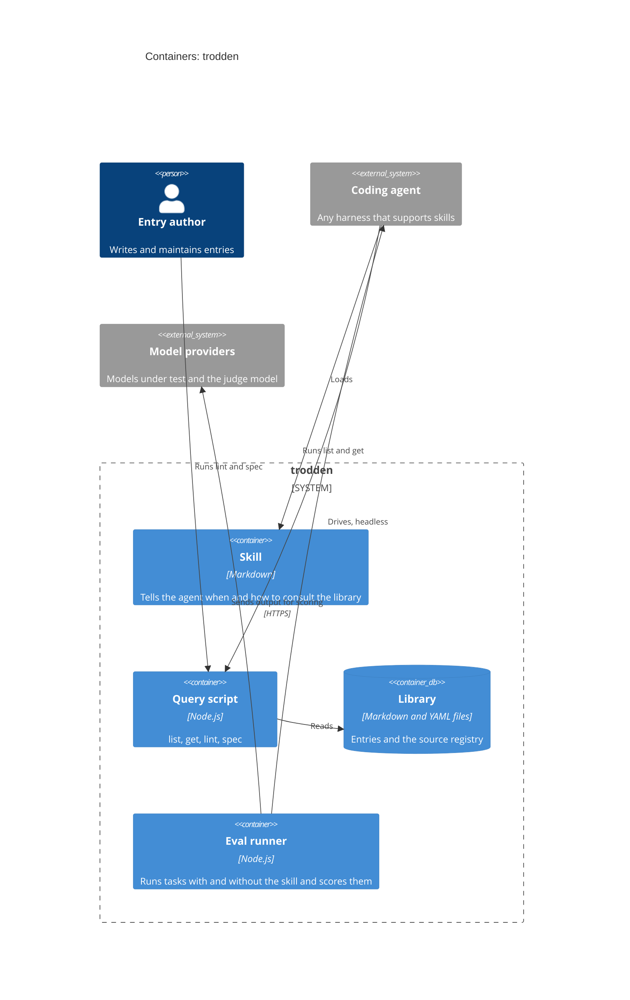

# trodden: project spec and first version

Date: 2026-11-16
Status: awaiting approval

Terms in **bold** on first use are defined in [`GLOSSARY.md`](../../../GLOSSARY.md).

## Intent

Ask five coding agents to "add logging" and you get five different answers. The established practice exists (OWASP, OpenTelemetry, The Twelve-Factor App), but it is not in the agent's context when it writes code.

trodden puts it there. It is two things:

1. A **library** of sourced, cross-cutting engineering practices, written as small markdown **entries**.
2. Tooling that grounds a coding agent in that library: a **skill** that tells the agent when to look something up, and a **query script** that returns exactly the right entries.

The result we want: whatever the model or harness, the agent's output follows the same sourced rules.

The mechanism is not tied to software engineering. The same format and tooling could ground a compliance agent in ISO 27001 or SOC 2 content. That is not being built, but it sets a constraint (see Constraints).

## Goals

- An entry format precise enough to be checked by a **linter**.
- A small `core` library that passes the linter with no errors.
- A skill and query script that work wherever the skill folder is copied, with no install step and no network.
- A small **eval** that shows whether the skill changes what agents produce.
- A repository whose layout, README and authoring rules describe the project as it now stands.

## Non-goals (first version)

Each of these came up and was deliberately deferred. They are listed again under Later.

- A **manifest** in consuming projects.
- **Packs** and copying a selection into a repo.
- Language **overlays**.
- An MCP server, a docs site or `llms.txt`.
- Publishing to npm.
- Previews, a leaderboard and a cross-model matrix.
- Checking a consuming project's code against rules with a deterministic script. Judging agent output belongs to the eval.

## Anti-goals

- **A dump.** The library is curated. An entry that is merely well classified does not qualify.
- **Unsourced authority.** A rule with no reputable source is never a **MUST**.
- **Context bloat.** The skill and the index stay short; the agent reads full entries only on demand.
- **A winner where sources disagree.** Competing established approaches both go in as **variants**; the project chooses.

## Constraints

- The skill folder is self-contained: the script, the format reference and the library ship inside it.
- The script is plain Node (version 20 or later), with no build step and no dependencies to install.
- The script reads local files only.
- Nothing in the script is specific to software engineering content. The only structure it knows is: **areas** contain **concerns**, concerns contain variants, variants hold **rules** that cite **sources**.
- A manifest can be added later without changing how the agent calls the script.

## Approaches

**What the script is written in** (Miguel chose option 1):

1. **Plain Node script, no build step (chosen).** One script inside the skill folder. Runs wherever Node is installed, which covers nearly every machine running a coding agent, and can be published to npm later without a rewrite.
2. **Python script.** Equally portable, but it does not lead to the `npx trodden add` idea in the original notes and would split the tooling across two languages.
3. **TypeScript package with a build.** Better once the tooling is large, but a copied skill folder would need compiled output or an install step.

**How the library reaches the agent** (decided in conversation):

1. **Skill with a query script (chosen).** The library ships with the skill; the agent calls the script. Nothing to host, works offline, the same in every harness that supports skills.
2. **MCP server over a master library.** The original idea, in the style of context7. Deferred: it adds a server for no gain while the library is small. It could later wrap the same script.
3. **Agent reads the markdown files directly.** Rejected: the agent decides what to read and guesses. The script makes selection deterministic.

## Design

### Repository layout

```
skills/trodden/            the skill, self-contained
  SKILL.md                 when and how to consult the library
  scripts/trodden.mjs      query script and linter
  references/format.md     the entry format and linter rules
  library/
    sources.yaml           source registry
    core/
      logging/
        _concern.md
        structured.md
evals/                     eval runner, tasks and results
test/                      tests for the script
docs/
  ideas/                   parked material (overlay, manifest example)
  superpowers/specs/       design docs
AGENTS.md                  authoring rules (points to format.md)
CLAUDE.md                  setup and test commands
GLOSSARY.md
README.md
```

The current `kb/` becomes `skills/trodden/library/core/`, and `sources/registry.yaml` becomes `skills/trodden/library/sources.yaml`.

### Entry format

`skills/trodden/references/format.md` is the single definition of the format. `AGENTS.md` keeps a short summary and points to it.

**Ids** follow the file path: a concern is `<area>/<concern>` (`core/logging`), a variant is `<area>/<concern>/<variant>` (`core/logging/structured`). Every **relationship** uses a full id. This replaces today's mixed scheme (`correlation-ids` beside `logging/audit-trail`).

**Frontmatter** is a restricted YAML subset, so the script can parse it without a dependency: `key: value` and `key: [a, b]` only.

| Field | Concern | Variant |
|---|---|---|
| `type` | `concern` | `variant` |
| `id` | required | required |
| `summary` | required, one line | required, one line |
| `sources` | optional | required if any rule cites one |

**Concern sections**, in order: Forces, Out of scope (optional), Related (optional). The table of variants is not written by hand; the script generates it from the variants' summaries and "Use when" text.

**Variant sections**, in order, each a `##` heading: Use when, Rules, Example, Avoid, Related.

**Rules** are list items that start with `MUST`, `MUST NOT`, `SHOULD` or `SHOULD NOT`. A MUST ends with one or more source ids in square brackets. A **SHOULD** may cite a source but need not.

**Related** is a list with one relationship per line: `- requires: core/tracing/correlation-ids`. A reference to an entry not yet written is marked `(planned)`.

- `requires` goes from a variant to a variant only. It is the one relationship `get` follows.
- `refines`, `conflicts-with` and `alternative` also go from a variant to a variant. `get` lists them but does not expand them.
- `see also` may point from any entry to any entry. It is the only relationship a concern may declare.

**Source registry**: `sources.yaml` maps each source id to a `title` and a `url`. It uses the same restricted subset plus exactly one level of nesting.

### Query script

Run as `node skills/trodden/scripts/trodden.mjs <command>`.

| Command | Returns |
|---|---|
| `list [<area or concern id>]` | The index: one line per concern and variant, with id and summary |
| `get <id>...` | The full entry. For a variant: its text, then each entry it requires (followed transitively, each included once), then its sources with titles and URLs. For a concern: its text plus the generated variants table |
| `lint [<path>]` | Findings for the library (see below) |
| `spec` | Prints `format.md`, for an agent that is writing entries |

- `list` and `get` print markdown by default, since an agent reads it. `--json` gives structured output.
- The library defaults to the one beside the script. `--library <path>` points at another, such as a private library.
- Exit codes: `0` success, `1` lint errors found, `2` bad usage or unknown id.
- All reading of the library goes through one function, which is where a manifest filter would later apply.

### Linter

In the style of the `@google/design.md` linter: named rules at fixed severities, JSON by default, exit code 1 only when there are errors. `--format text` gives a readable report.

```json
{
  "findings": [
    { "rule": "broken-ref", "severity": "error",
      "path": "core/logging/structured.md",
      "message": "requires core/tracing/correlation-ids, which does not exist" }
  ],
  "summary": { "errors": 1, "warnings": 0, "info": 0 }
}
```

| Rule | Severity | Checks |
|---|---|---|
| `frontmatter` | error | Required fields present and valid for the entry's type |
| `id-path` | error | The id matches the file's path; no two entries share an id |
| `section-order` | error | Required sections present, in order, with no duplicates |
| `uncited-must` | error | Every MUST cites at least one source |
| `unknown-source` | error | Every source id exists in the source registry |
| `broken-ref` | error | Every relationship target exists, unless marked planned, and is of a type that relationship allows |
| `requires-cycle` | error | `requires` relationships do not form a loop |
| `length` | warning | A variant's body is over 400 words |
| `language-specific` | warning | A fenced code block declares a programming language |
| `planned-ref` | info | A relationship points to a planned entry |
| `orphaned-source` | info | A source in the registry is cited nowhere |

The linter judges form only. Whether an entry deserves to be in the library is an editorial decision (below).

### The skill

`SKILL.md` stays short. It tells the agent:

- **When:** before writing or changing code that touches a cross-cutting concern.
- **How:** run `list`, pick the entries that apply, run `get` on them, and read the result before writing code.
- **What to do with it:** follow every MUST, treat each SHOULD as the default, and apply the rules with the language and libraries the project already uses.
- **What to report:** which entries it consulted.

The folder follows the Agent Skills layout so it can be copied into any harness that supports skills. Making it installable as a Claude Code plugin from this repo is part of the first version.

### Library content and editorial rules

The first version of `core` holds three concerns, the ones the original roadmap named as seeds: logging, error handling and retries, and configuration. Each has at least one variant. Every relationship resolves or is marked planned.

The existing logging entries are migrated to the new format. Their forward references (`correlation-ids`, `audit-trail`) are either written or marked planned. The logging concern's `requires` on correlation ids moves down to the structured variant, since a concern may only declare `see also`.

An entry belongs in the main library only if it passes four tests:

1. **Cross-cutting:** it applies across projects and languages. Framework and library documentation stays out.
2. **Sourced:** at least one reputable reference supports it.
3. **Actionable:** it can be written as rules an agent can follow and a reviewer can check.
4. **Established:** widely documented practice over novelty.

These tests apply to the main library only. A private library can admit what it likes; the format rules apply to every library.

Entries are language-neutral. Examples are pseudocode. The library grows by adding areas beside `core` (for example web APIs, or a regulated domain).

### Eval

A small script in `evals/`, run by hand, not in CI. It answers two questions: does the agent consult the library, and does its output then follow the rules.

- A **task** is a prompt ("add logging to this service"), a small fixture project, and the variant ids whose rules apply.
- Each task runs twice per model: once with the skill available, once without.
- A judge model scores the resulting change against each MUST of the listed variants: pass, fail or not applicable.
- The runner also records whether the agent called the query script.
- Output is a results file and a short markdown summary: adherence with and without the skill, per task and model.

The first version covers three to five tasks on one or two models, through one harness (Claude Code in headless mode), behind an interface that lets other harnesses be added. It informs the format; it is not yet a gate on shipping an entry.

The build delivers the runner, tested against a stub harness so the tests need no credentials. A real run needs paid model access and is the last step (see Decided after review).

### Build order

Most of the work rests on the format, and several format decisions are Claude's calls. So the plan puts `format.md` and one migrated entry (`core/logging/structured`) first and has Miguel review them before the linter, the remaining entries and the eval are built.

### Tests and CI

- Unit tests for the script use Node's built-in test runner against small fixture libraries, one per linter rule plus the query commands.
- CI runs the tests and `lint` on the real library on every push.
- `CLAUDE.md` gets a `## Setup and test commands` section with these commands. It does not exist yet and must be filled in by the first task of the plan, before any implementation.

### Housekeeping

- `README.md` is rewritten to describe this shape, with the roadmap split into "first version" and "later". The step that promised a lint-style check of agent output is removed.
- `AGENTS.md` drops the overlay rule and points to `format.md`.
- `kb/logging/structured.js.md` and `examples/patterns.yaml` move to `docs/ideas/` with a note on why they are parked.

## Later

In rough order of when each becomes useful:

1. **Manifest.** Useful once the index is noisy or a concern has several variants. Narrows the library for a project and records chosen variants.
2. **Packs and vendoring.** `trodden add` copies a selection into a repo, pinned and diffable against upstream.
3. **Overlays.** Only if evals show agents need the library pinned per language.
4. **Other delivery routes.** npm publication, an MCP server, a docs site and `llms.txt`, a per-message hook.
5. **Evals as a gate, previews and leaderboard.** Grown from the first eval script.
6. **More areas and private libraries.** Domain areas such as healthcare; multiple libraries queried together.

## Calls made by Claude

Not decided by Miguel; correct any of these.

- Sections are `##` headings, including "Use when" (today it is an inline line).
- A `summary` frontmatter field feeds the index.
- Relationships live in the Related section, one per line, using full ids.
- Only `requires` is expanded by `get`, and it is variant to variant; a concern may declare only `see also`.
- Ids take the form `<area>/<concern>/<variant>`.
- Frontmatter and the source registry use a restricted YAML subset, to avoid a dependency.
- The concern's variants table is generated, not hand-written.
- The linter ships in the same script as the query commands.
- The first library holds three concerns.
- The eval runs through Claude Code headless first.
- The term is "library", not "knowledge base"; "area" names a top-level group.
- Parked material goes to `docs/ideas/`.

## Left to the builder

- The script's internal structure and its frontmatter parser.
- The exact wording of `SKILL.md` and of linter messages.
- How the `language-specific` warning is detected beyond the declared fence language.
- The Claude Code plugin manifest, checked against current documentation.
- The eval's task fixtures, judge prompt and results layout.
- Which variants are written for error handling and configuration, and their sources.

## Decided after review

- **The real eval run** is in scope, as the last step: two Claude models of different sizes, with a stronger one as judge, using a key Miguel provides. If adherence does not improve with the skill, the format or `SKILL.md` is revised before more entries are written. The run waits on the key; nothing else does.
- **Licence:** MIT for the script and tooling, CC BY 4.0 for the library entries. The repo gets a `LICENSE` file for the code and a `LICENSE` file inside `skills/trodden/library/` for the entries, and the README states both.
- **Source text is never copied.** Entries state rules in their own words and cite the source. Some sources are share-alike licensed (the OWASP cheat sheets are believed to be; confirm before publishing).

## Proposed domain model



- A **Library** contains one or more **Areas** and has exactly one **Source registry**.
- A **Source registry** lists zero or more **Sources**.
- An **Area** groups one or more **Concerns**.
- A **Concern** offers one or more **Variants**.
- A **Variant** states one or more **Rules**.
- A **Rule** cites zero or more **Sources**.
- A **Variant** relates to other **Variants** through **Relationships**.
- A **Concern** may point to other **Concerns** with a `see also` **Relationship**.

Invariants:

- Every MUST cites at least one Source.
- Every cited Source is in the Source registry of the same Library.
- Every Relationship target exists in the Library or is marked planned.
- `requires` Relationships never form a loop.
- An Entry's id always matches its location in the Library.

## Proposed architecture





## Documentation impact

- **`GLOSSARY.md`:** created alongside this spec with the terms above. Update if the build changes a term.
- **`docs/domain-model.md`:** create from the proposed domain model once the format and linter are built.
- **`docs/architecture/c4-context.md`, `c4-containers.md`, `README.md`:** create from the proposed diagrams once the skill, script and eval runner exist.
- **ADR candidates:**
  - The library ships inside the skill and is queried by a local script, not served by an MCP server.
  - Entries are language-neutral, with no overlays in the first version.
- **`ARCHITECTURE.md`:** add with the plan that creates the first source modules, with its update triggers in `CLAUDE.md`.
